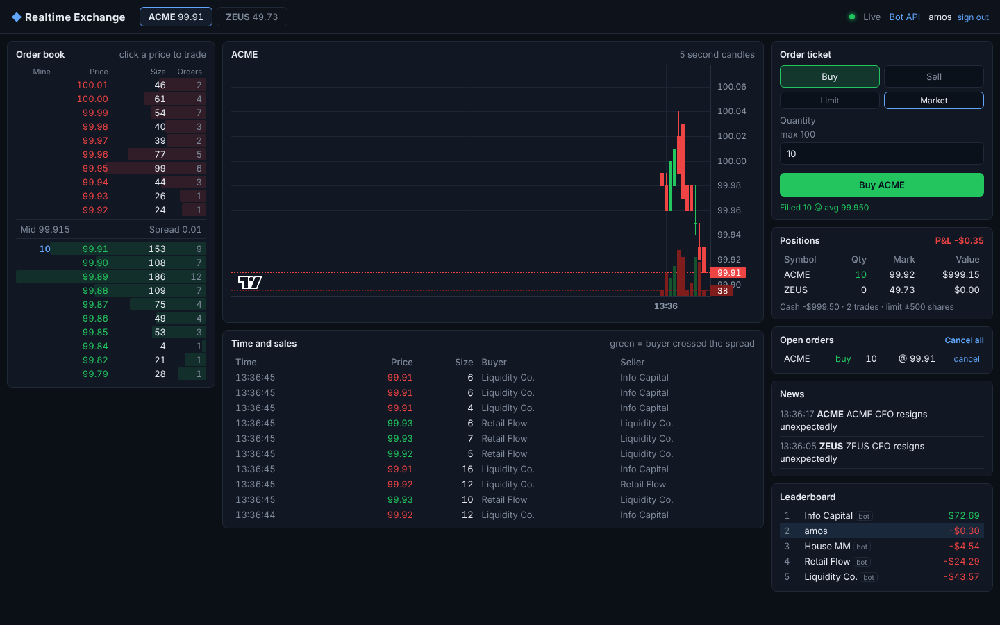

# Realtime Trading Exchange

A full stack stock exchange you can trade on live: a C++ matching engine, a Python API that streams market data over WebSockets, a React trading screen, and simulated traders that keep the market moving. People can trade by hand in the browser, or write Python bots that connect through the API and compete on the same leaderboard.

I built it to understand what happens inside an exchange and to practice for trading competitions, which run on this kind of setup: a live order book, news that moves prices, position limits, and a leaderboard.



## Highlights

* **C++17 matching engine** with price and time priority, O(1) cancels and self trade prevention. Handles about **3 million orders per second** with a median latency under **200 ns** on one core (benchmark below).
* **Python bindings** (pybind11) so the FastAPI server calls the engine directly, at about 750,000 orders per second including the Python overhead.
* **Live market** pushed to every client 4 times a second over WebSockets: order books, trades, news, account and leaderboard.
* **Risk checks** on every order: position limits that count resting orders, maximum order size, a price band around the market, and a per account rate limit.
* **Simulated market** with a hidden fair value, news events, and four bots with different behavior (see below), so there is always something to trade against.
* **Bot API and Python SDK**, with an example inventory skew market maker.
* **Tested**: 11 C++ engine tests and 18 API tests, including checks that shares and cash always net to zero across accounts and that every order id is unique. A GitHub Actions pipeline builds the engine, runs the tests and the benchmark, and builds the frontend.
* **One writer at a time**: every API endpoint runs on the same event loop as the market simulation, so requests never race the bots for the order book or the database. Verified with 24 concurrent clients sending 3,600 requests.

## How it fits together

```
 Browser (React + TypeScript)        Python bots (sdk/)
         │  REST + WebSocket                 │
         └───────────────┬───────────────────┘
                         ▼
          FastAPI server (server/app)
     accounts · risk checks · P&L · SQLite
     market simulation loop (4 Hz)
                         │ pybind11
                         ▼
          C++ matching engine (engine/)
     std::map price levels · FIFO queues
```

Each book hands out order ids on its own stride (ACME 1, 3, 5... ZEUS 2, 4, 6...), so an id is unique across the whole exchange.

## The market

Each stock has a hidden fair value that drifts randomly and jumps when a news headline comes out. Four bots trade around it:

| Bot | Behavior | Why it is there |
|---|---|---|
| Liquidity Co. | Posts passive orders around a *slow* estimate of fair value | Keeps the book full, and its quotes go stale right after news |
| Retail Flow | Random market orders | Uninformed flow that market makers earn the spread from |
| Info Capital | Knows fair value and trades only when the book is mispriced | Adverse selection: punishes stale quotes |
| House MM | Inventory aware market maker | A benchmark for your own market making |

So the edges a human or bot can chase are the same ones competition cases test: react to news faster than the slow liquidity, provide liquidity without getting picked off, and manage inventory inside the position limit.

## Engine benchmark

Random message mix: 60% limit orders near the touch, 32% cancels, 8% market orders, 2 million messages.

```
$ ./engine/build/engine_bench
messages        2000000 (adds 1200329, cancels 639279, market 160392)
trades          675386
throughput      2.78 million msgs/sec
latency p50     195 ns
latency p99     1253 ns
latency p99.9   3446 ns
```

Measured on a shared cloud vCPU, where throughput varies between about 2.8 and 3.2 million per run. Latency includes the cost of reading the clock.

## Run it

**With Docker**

```bash
docker compose up --build
# open http://localhost:8000
```

**By hand**

```bash
# 1. C++ engine: native tests and benchmark
cmake -S engine -B engine/build -DCMAKE_BUILD_TYPE=Release
cmake --build engine/build -j
./engine/build/engine_tests
./engine/build/engine_bench

# 2. Python bindings and API server
pip install ./engine
pip install -r server/requirements.txt
cd server && uvicorn app.main:app --port 8000

# 3. Trading screen (in another terminal)
cd web && npm install && npm run dev
# open http://localhost:5173
```

Run the API tests with `python -m pytest server/tests`.

## Write a bot

Interactive API docs are at `http://localhost:8000/docs`. The SDK wraps them:

```python
from exchange_client import ExchangeClient

client = ExchangeClient("http://localhost:8000")
client.register("my_bot")

for update in client.stream():          # one message every 250 ms
    book = update["books"]["ACME"]
    if update["news"]:
        print(update["news"][0]["headline"])
    client.buy("ACME", qty=10, price=book["bids"][0]["price"])
```

Try the example market maker:

```bash
python sdk/examples/market_maker_bot.py --name my_mm --symbol ACME --seconds 120
```

### API

| Method | Path | What it does |
|---|---|---|
| POST | `/api/register` | Create a trader, returns an API key |
| GET | `/api/book/{symbol}` | Order book levels |
| GET | `/api/trades/{symbol}` | Recent trades |
| GET | `/api/candles/{symbol}` | 5 second OHLCV candles |
| GET | `/api/news`, `/api/leaderboard` | Headlines and rankings |
| GET | `/api/me`, `/api/orders` | Your positions, P&L and open orders |
| POST | `/api/orders` | Limit or market order |
| DELETE | `/api/orders/{id}`, `/api/orders` | Cancel one or all |
| WS | `/ws?api_key=...` | Live stream of all of the above |

Private endpoints need an `X-API-Key` header.

## Project layout

```
engine/   C++ order book, native tests, benchmark, pybind11 bindings
server/   FastAPI app: exchange, risk checks, bots, SQLite store, tests
web/      React + TypeScript trading screen (Vite, Lightweight Charts)
sdk/      Python client and example bot
```

## What I would add next

* Options on each stock, so traders can practice pricing and hedging Greeks.
* Timed rounds with a final settlement price, like a competition case.
* Replay of a session from the SQLite trade log.
